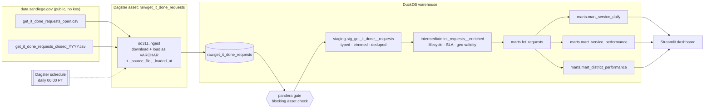

# sd-open-data-pipeline

[](https://github.com/SuperJohn/sd-open-data-pipeline/actions/workflows/ci.yml)
[](https://superjohn.github.io/sd-open-data-pipeline/)
  

An end-to-end, production-shaped analytics pipeline over the City of San Diego's
**Get It Done (311)** service requests: potholes, streetlights, graffiti, illegal
dumping, and so on.

**Extract → DuckDB → dbt (staging → intermediate → marts) → data-quality gates → Dagster
schedule → Streamlit dashboard.** It runs on a laptop in under a minute against the full
~400k-row live extract, and fully offline against a checked-in sample (that's what CI uses).


## Why this exists

Most "portfolio pipelines" stop at a notebook. This one is built the way I'd build a
small team's first production pipeline:

- **Idempotent, replayable loads.** Raw data lands as untyped VARCHAR with file lineage, and
  all typing and cleaning happens in version-controlled SQL.
- **Layered dbt models** with tests at every layer, including custom generic tests and a
  reconciliation test between the fact table and the aggregates.
- **A blocking quality gate before transformation.** A pandera schema check runs as a
  Dagster asset check, so a broken extract never reaches the marts.
- **Orchestration as software-defined assets.** dbt models and tests show up in Dagster as
  assets and asset checks, with one lineage graph from the CSV to the dashboard.
- **Source freshness with alerting.** dbt watches `_loaded_at`; a Dagster sensor polls load
  and city-feed clocks and requests a live refresh when either goes stale.
- **Laptop-to-CI parity.** The same `make` targets run locally and in GitHub Actions.

## Architecture



## Quickstart

Requires Python 3.11+ and [uv](https://docs.astral.sh/uv/).

```bash
make setup                # uv sync + dbt parse
make run                  # Dagster: ingest sample -> pandera gate -> dbt build (models + tests)
make dashboard            # http://localhost:8501

make run SOURCE=live      # same pipeline against today's full extract (~140 MB download)
make dev                  # Dagster UI at http://localhost:3000 (lineage, checks, schedule)
make test                 # ruff + pytest (unit + dbt integration)
make freshness            # dbt source freshness against the current warehouse
make docs                 # dbt docs site -> ./site (also deployed on main)
```

Without Dagster, the same flow is `make ingest && make dbt-build`.

### With Docker

One command builds the image, runs the pipeline once on the sample data, and then
starts the Dagster UI and the dashboard (requires Docker with Compose v2):

```bash
docker compose up --build              # or: make up / make down
# Dagster UI  http://localhost:3000    Dashboard  http://localhost:8501

SD311_SOURCE=live docker compose up --build   # same stack against the live extract
```

All three services share one image (`docker/entrypoint.sh` picks the role: `pipeline`,
`dagster`, or `dashboard`) and one named `warehouse` volume holding the DuckDB file.
The dashboard and Dagster wait for the pipeline to finish before starting. CI builds the
image and smoke-tests the whole stack on every push.

## Data lineage

| Layer | Object | Grain | What happens |
|---|---|---|---|
| raw | `raw.get_it_done_requests` | one row per CSV row | Full refresh from the open and current-year closed extracts. All VARCHAR, plus `_source_file` and `_loaded_at`. |
| staging | `stg_get_it_done__requests` | `service_request_id` | Casts with `try_cast`, trims, and turns empty strings into NULL. **Dedupes requests that appear in both extracts** while they transition, preferring the closed record. |
| intermediate | `int_requests__enriched` | `service_request_id` | `days_to_close`, `open_age_days`, `is_open`, channel (self-service, assisted, or internal), calendar fields, and **geo validity against the city bounding box**. |
| marts | `fct_requests` | `service_request_id` | Analytics-ready fact with `closed_within_sla` (30 days by default, via `var('sla_days')`). Invalid geocodes are nulled. |
| marts | `mart_service_daily` | `requested_date × service_name` | Opened, closed, and still-open counts, plus median days to close. |
| marts | `mart_service_performance` | `service_name` | Volume, median and p90 days to close, SLA %, backlog, and self-service %. |
| marts | `mart_district_performance` | `council_district` | District scorecard. |

## Data-quality checks: what they catch

| Where | Check | Catches | Severity |
|---|---|---|---|
| Ingest (schema contract) | CSV headers match EXPECTED_COLUMNS | added or removed columns in the source extract | **block** |
| Pre-dbt (pandera, Dagster blocking check) | required columns present; no unexpected columns | upstream schema changes or renamed columns | **block** |
| | `service_request_id` unique and not null | a bad extract or double load | **block** |
| | `date_requested` parseable, `status` in the known set | format drift or new status codes | **block** |
| | ≥ 100 rows | an empty or truncated download | **block** |
| dbt source | `not_null` keys, `min_row_count` | the same issues, at the dbt layer | error |
| dbt source freshness | `_loaded_at` warn 24h / error 48h (`dbt source freshness`) | missed ingest or a stuck schedule | warn / error |
| Pre-dbt (freshness gate) | load age (`_loaded_at`) and city-feed age (`date_requested`) | warehouse not refreshed, or city extract stopped updating | warn / error |
| Dagster freshness | `FreshnessPolicy` on raw asset + `city_feed_freshness_sensor` | alerts and requests a live refresh when clocks exceed error thresholds | alert |
| staging | `unique` / `not_null` PK, `accepted_values(status)` | broken dedupe logic, new statuses | error |
| | `in_range(council_district, 1, 9)` | bad district codes | error |
| | `not_before(closed_at, requested_at)` | requests closed before they were opened | warn |
| | `max_null_fraction(latitude / council_district, 5%)` | a geocoding outage upstream | warn |
| | `assert_no_requests_in_future` | timezone or parse bugs | error |
| intermediate | `in_range(days_to_close, 0, 3650)` | decade-old tickets closed in bulk (data hygiene) | warn |
| marts | PK tests, `unique_combination(date, service)` | fan-out in aggregates | error |
| | `assert_daily_mart_reconciles_to_fact` | aggregates that drop or double-count rows | error |
| | `in_range(pct_closed_within_sla, 0, 100)`, `latitude` within the bbox | metric bugs, leaked bad geocodes | error |

On the **live** extract (Oct 2026, 409,547 requests) the pipeline passes with **2
warnings**, both real findings in the source data: one request closed before its
open date, and one ticket that took more than 10 years to close. Warnings surface in
Dagster as failed (non-blocking) asset checks, so they're visible without paging anyone.

**Known coverage caveat (found while building the dashboard):** the city publishes
*open* requests plus requests *closed in a given year*. Without the prior-year closed
files, earlier periods are under-counted, so the dashboard trend is limited to the
current year. Loading historical closed files is on the roadmap.

## Project layout

```
src/sd311/
  config.py         # env-driven settings (SD311_SOURCE, SD311_DUCKDB_PATH)
  contracts.py      # raw CSV schema contract (fail fast on column drift)
  ingest.py         # download + load to DuckDB (CLI: python -m sd311.ingest)
  quality.py        # pandera pre-transform gate
  freshness.py      # load + city-feed freshness clocks (dbt + Dagster sensor)
  definitions.py    # Dagster assets, checks, dbt assets, job, schedule, freshness sensors
  docs.py           # package dbt docs artifacts for GitHub Pages
dbt/
  docs/overview.md  # dbt docs homepage
  models/{staging,intermediate,marts}/
  tests/generic/    # in_range, not_before, max_null_fraction, min_row_count, unique_combination
  tests/singular/   # reconciliation + future-dated requests
dashboard/app.py    # Streamlit over the marts
docker/entrypoint.sh # container roles: pipeline | dagster | dashboard
data/sample/        # 4,000-row sample (1,500 open + 2,500 closed), free-text column removed
tests/              # pytest: ingest, quality gate, dbt integration, Dagster definitions
```

## Roadmap

- [ ] Incremental loads: partition by close year, `is_incremental()` models, Dagster partitions
- [ ] Backfill prior years' closed extracts to remove the coverage caveat
- [ ] Spatial join to official council district and community plan polygons (DuckDB `spatial`)
- [x] dbt source freshness, plus Dagster FreshnessPolicy and city-feed alert sensor
- [ ] Snapshot (SCD2) of request status to measure reopen rates
- [ ] Publish marts to MotherDuck or Parquet on S3 and deploy the dashboard
- [x] Publish dbt docs to GitHub Pages (CI builds `site/`, deploys on main)
- [ ] Data contracts on the marts (dbt model contracts + versioned schemas)

## Data & license

Data: [City of San Diego Open Data Portal, Get It Done](https://data.sandiego.gov/datasets/get-it-done-311/),
published under the portal's open data terms. The in-repo sample drops the free-text
`public_description` column. Code: MIT.
